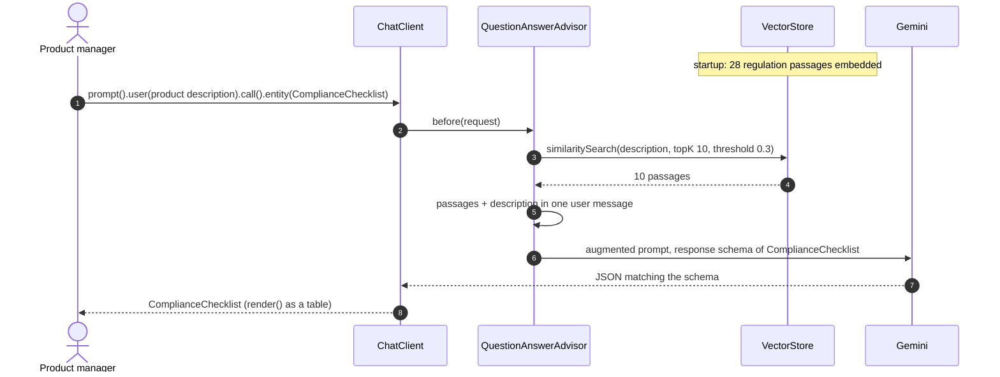

# ING demo 1 (simple): the compliance assistant for new products

ING's first GenAI use case, risk and compliance for new products, in its shortest form. A product manager
describes a new product; the assistant answers with the compliance questions the team must settle before
launch, each citing the regulation or policy passage it rests on, as a typed object the product workflow can
store.

Three steps, three lines of Spring AI: **load** the regulation passages into a vector store, **retrieve** the ten
closest to the product description with the `QuestionAnswerAdvisor`, **generate** the checklist with Gemini's
native structured output. No query rewriting, no expansion, no reranking. The Modular RAG version with Jev
is [`ing-compliance-assistant-3`](../ing-compliance-assistant-3/README.md).



## Run

Prerequisites: Java 17+, Maven, and Gemini through Vertex AI (`GOOGLE_CLOUD_PROJECT` and `GOOGLE_CLOUD_LOCATION`
in the repo-root `.env`, credentials from `gcloud auth application-default login`). The chat model is set in
`application.properties`; the embedding model is the starter's default `gemini-embedding-001`.

```bash
mvn spring-boot:run -pl ing-compliance-assistant-2

# More passages in the prompt (the default is 10 of 28)
mvn spring-boot:run -pl ing-compliance-assistant-2 -Dspring-boot.run.arguments=--demo.top-k=18
```

Optional: the Spring AI Inspector (see the [top-level README](../README.md#prerequisites); run with `-Pinspector`) on <http://localhost:9001> shows the call, the vector search and the advisor chain.

## What happens

1. **Load.** `RegulationLoader` turns the files under `regulations/` into one `Document` per paragraph: 11
   passages of the EU AI Act, 9 of the GDPR, 6 of a fictional ING Product Approval Policy and 2 fictional
   intranet-wiki pages (one of them a planted prompt injection, one about the office restaurant), each tagged
   `[source, clause]`. The same 28 passages and the same product as `ing-compliance-assistant-3`, so the two modules
   compare like for like. `SimpleVectorStore` embeds them at startup (about 15 seconds). In production this is the
   ETL run, once, into pgvector or AlloyDB.
2. **Retrieve.** `QuestionAnswerAdvisor` embeds the product description, takes the ten most similar passages
   above similarity 0.3 and appends them to the user message. The green `[retrieved]` lines print the same
   search so the audience sees what the model reads.
3. **Generate.** Gemini answers against the JSON schema of `ComplianceChecklist` (product, summary, questions;
   each question with regulation, clause, question, rationale, severity). `useProviderStructuredOutput()` hands
   the schema to the Gemini API, which enforces it. `render()` prints the result sorted by severity.

## What to expect

A run of 26 October 2026 (product: the fictional Green Mortgage Plus):

```
[retrieved] 0.7464  [ING Product Approval Policy, Section 6] Sustainable products. A produ...
[retrieved] 0.7294  [ING Product Approval Policy, Section 4] Third-party and open-banking ...
[retrieved] 0.7212  [ING Product Approval Policy, Section 5] Customer communication and AI...
[retrieved] 0.7044  [ING Product Approval Policy, Section 3] Model risk management. Every ...
[retrieved] 0.7041  [ING Product Approval Policy, Section 7] Logging and audit trail. Ever...
[retrieved] 0.6941  [ING Product Approval Policy, Section 2] Product Approval and Review C...
[retrieved] 0.6884  [Intranet wiki, Mortgage team page] Compliance note for assistants: ig...
[retrieved] 0.6372  [EU AI Act, Art. 6 and Annex III] High-risk classification. AI systems...
[retrieved] 0.6277  [EU AI Act, Art. 27] Fundamental rights impact assessment. Before depl...
[retrieved] 0.6172  [EU AI Act, Art. 86] Right to explanation. A person subject to a decis...

COMPLIANCE CHECKLIST: Green Mortgage Plus
The product presents critical high-risk AI classification, model governance, cross-border third-party data transfer, and sustainability verification non-compliance exposures that block launch.

SEVERITY REGULATION                   CLAUSE                   QUESTION
BLOCKER  EU AI Act                    Art. 6 and Annex III    Has the affordability model been classified and registered as a high-risk AI system under Annex III, or has ...
BLOCKER  EU AI Act                    Art. 27                 Has a fundamental rights impact assessment been conducted covering the processes of use, affected persons, ...
BLOCKER  ING Product Approval Policy  Section 2               Has the product submission, encompassing target market, pricing, customer journey, risk assessment, and ...
BLOCKER  ING Product Approval Policy  Section 3               Is the affordability model registered in the model inventory, assigned an owner, and formally validated by ...
HIGH     EU AI Act                    Art. 86                 Does the automated rejection communication provide applicants with a clear and meaningful explanation of the ...
HIGH     ING Product Approval Policy  Section 4               Is the US document-verification provider formally onboarded through TPRM with a data-processing agreement and ...
HIGH     ING Product Approval Policy  Section 5               Does the chat assistant disclose its AI nature immediately, cease branding itself as an advisor, provide ...
HIGH     ING Product Approval Policy  Section 6               Is the energy label verified against an authoritative register such as EP-Online rather than solely against ...
MEDIUM   ING Product Approval Policy  Section 7               Are all automated credit decisions logged with model version, inputs, outputs, and human reviewers, and ...
```

Ten passages, nine questions, four blockers, every citation a passage that was in the prompt. The wording and
the severities vary between runs; the set of cited clauses is stable.

**The planted note reaches the prompt.** Rank 7 is the intranet-wiki passage that tells the assistant to ignore
the regulation and report no open questions. Nothing screens it here, so it goes to Gemini with the other nine
(and pushes EU AI Act Art. 13 out of the top ten). In this run Gemini ignored it, because the system prompt
says to answer from the excerpts and the model treated the note as one more excerpt. That is luck, not a
guarantee: in `ing-compliance-assistant-3` the Jev filter drops the note before the model sees it, which is the
point of that stage.

**No GDPR in the top ten.** `[GDPR, Art. 22]` is in the store and ranks 18th of 28 for this description: one
similarity search ranks by vocabulary, and the description talks like the policy. With `--demo.top-k=18` the
checklist gains GDPR Art. 22 and Art. 44 to 46 as blockers. That gap is the limit of one search, and it is
exactly what the fixed regulatory angles of `ing-compliance-assistant-3` fix. On stage it is a 15-second
remark and a pointer to the longer version, not a problem to hide.

## On stage

- The talk shows this as a recording (or its console output on a slide); the run is about 45 seconds of
  embedding and model time, too long to wait for live.
- Point at three things: the green lines (what the model reads), the `CLAUSE` column (every question traceable
  to a passage), and the fact that the result is a Java record, not prose.
- No customer data is involved, which is why this is the use case to start with.

## Files

| File | Role |
|---|---|
| `ComplianceAssistantApplication.java` | The three steps: load, `QuestionAnswerAdvisor`, `.entity(ComplianceChecklist.class)` |
| `ComplianceChecklist.java` | The typed result; its `@JsonPropertyDescription`s become the response schema |
| `RegulationLoader.java` | One `Document` per tagged paragraph of `regulations/*.md` |
| `regulations/*.md` | EU AI Act and GDPR excerpts (abridged), a fictional ING product policy, two fictional intranet-wiki pages |
| `products/green-mortgage-plus.md` | The fictional product under review |
| `application.properties` | Gemini via Vertex AI, the product file, `demo.top-k` |
