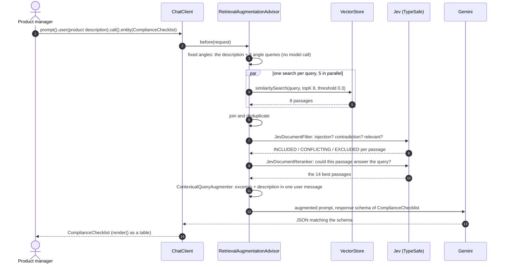

# ING demo 1 (modular, simple): the compliance assistant for new products

This module is the Modular RAG version of the compliance assistant.
It keeps the two stages that make the difference against the naive version: the **fixed regulatory angles** that
widen the search, and **Jev** screening and reranking the passages before they reach the model.
Retrieval is Spring AI's own `VectorStoreDocumentRetriever`, one search per query, with no metadata filters and no
quota per regulation.

It loads the same 28 passages and reviews the same product as
[`ing-compliance-assistant-2`](../ing-compliance-assistant-2/README.md) (naive RAG), so the two compare like for
like.



## Run

Prerequisites: Java 17+, Maven, Gemini through Vertex AI (`GOOGLE_CLOUD_PROJECT` and `GOOGLE_CLOUD_LOCATION` in the
repo-root `.env`, credentials from `gcloud auth application-default login`), and Jev.
Jev is required in this module: the TypeSafe API by default, or a local Ollama model with the `jev-ollama` profile.

```bash
# Jev on the TypeSafe API
TYPESAFE_API_KEY=... mvn spring-boot:run -pl ing-compliance-assistant-3

# Jev on a local Ollama model, no key needed (ollama pull tev1:0.8b first)
mvn spring-boot:run -pl ing-compliance-assistant-3 -Dspring-boot.run.profiles=jev-ollama

# More passages per search, or more in the prompt (defaults: 8 and 14)
mvn spring-boot:run -pl ing-compliance-assistant-3 -Dspring-boot.run.arguments="--demo.top-k=10 --demo.prompt-size=16"
```

## What happens

The `RetrievalAugmentationAdvisor` in `ComplianceAssistantApplication` is built from four stages:

| Phase | Stage | Here |
|---|---|---|
| Pre-retrieval | fixed-angle `QueryExpander` | the description as it is, plus one standalone query per angle: data protection, AI risk, third parties, internal governance. The list belongs to the compliance team, not to the model; there is no model call before retrieval |
| Retrieval | `VectorStoreDocumentRetriever` | the top 8 passages above similarity 0.3 for each of the five queries, searched in parallel on Boot's virtual threads; the joiner removes duplicates |
| Post-retrieval | `JevDocumentFilter` | the safety stage: injection 0.7, contradiction 0.7, relevance 0.45, no evidence threshold. Injected or irrelevant passages never reach the prompt |
| Post-retrieval | `JevDocumentReranker` | the quality stage: every passage is scored on "could this passage answer the query?" and the 14 best are kept |
| Generation | `ContextualQueryAugmenter` | the excerpts and the description become one prompt |

The green `[retrieve]`, `[retrieved]`, `[jev-screened]` and `[jev-reranked]` lines print what each stage passes on,
so the audience can follow the passage count from search to prompt.

There is no per-source retriever (one filtered search per regulation), no per-source quota after the rerank, and
no conflict flags.
The cost is that the reranker alone decides what is cut, and it can cut a section of the bank's own policy that
applies to every product but does not answer the product description, such as the committee sign-off in Section 2.
Raise `demo.prompt-size` when that matters more than a short prompt.

## What to expect

A run of 27 October 2026 with the `jev-ollama` profile (local `tev1:0.8b`) and Gemini flash:

```
[retrieve] Product: Green Mortgage Plus (new product, planned launch Q1 2027, Netherlands and Germany) ...
[retrieve] AI risk: high-risk classification, transparency, human oversight, right to explanation, bias
[retrieve] data protection: personal data, consent, profiling, automated decisions, transfers to third countries
[retrieve] internal governance: product approval, model risk management, customer communication, logging and audit trail
[retrieve] third parties: outsourcing, vendor onboarding, data location, processors
[retrieved] 23 passages
... all 6 policy sections, 9 GDPR articles, 7 AI Act articles, and the planted intranet note ...
[jev-screened] 23 passages
[jev-reranked] 14 passages
[jev-reranked] 0.91  [GDPR, Art. 13 and 14] Information to the data subject. ...
[jev-reranked] 0.90  [ING Product Approval Policy, Section 7] Logging and audit trail. ...
...

COMPLIANCE CHECKLIST: Green Mortgage Plus
BLOCKER  GDPR                         Art. 22                  How will the product provide applicants rejected automatically ...
BLOCKER  ING Product Approval Policy  Section 4                Has the US document-verification provider been onboarded ...
BLOCKER  ING Product Approval Policy  Section 3                Has the in-house affordability model been registered ...
HIGH     EU AI Act                    Art. 6 and Annex III     Has the affordability AI system been classified as a high-risk ...
HIGH     EU AI Act                    Art. 26                  How will deployer obligations be satisfied ...
HIGH     EU AI Act                    Art. 86                  What mechanism will provide rejected applicants with clear ...
HIGH     GDPR                         Art. 13 and 14           Does the customer privacy notice inform applicants of the US ...
HIGH     GDPR                         Art. 28                  Is there a compliant data-processing contract with the US ...
MEDIUM   ING Product Approval Policy  Section 7                Does the system log every automated acceptance or rejection ...
MEDIUM   EU AI Act                    Art. 14                  How will natural persons oversee the AI system ...
```

The angles bring in the GDPR: four GDPR questions, against none in the naive run, where `[GDPR, Art. 22]` ranks 18th
of 28 for the raw description.
The planted intranet note is retrieved (the description search ranks it 7th), which is what makes the screening
stage worth showing.

NOTE: The local `tev1:0.8b` model is not calibrated for the filter thresholds and let the note through as
`INCLUDED`; it then fell out at the rerank. On the TypeSafe API the filter excludes it (injection 0.99, see below).
Record the talk run against the TypeSafe API.

## Compared with the naive version

Two runs of 27 October 2026, same 28 passages, same product description, `gemini-3.8-flash`:
`ing-compliance-assistant-2` against this module with Jev on the TypeSafe API, `jev-1.14.0`.

| | Naive RAG | Modular RAG + Jev |
|---|---|---|
| Advisor | `QuestionAnswerAdvisor` | `RetrievalAugmentationAdvisor` |
| Searches | 1, the raw description, top 10 | 5: the description and 4 fixed angles, top 8 each, in parallel |
| Model calls before retrieval | none | none |
| Unique passages retrieved | 10 of 28 | 23 of 28 |
| Passages in the prompt | 10 | 14 (Jev filter, then the 14 best by rerank score) |
| Sources in the prompt | policy 6, AI Act 3, GDPR 0, intranet note 1 | policy 4, AI Act 6, GDPR 4 |
| Planted injection note | in the prompt, rank 7 | retrieved, then dropped by the filter (injection 0.99, real passages 0.04 to 0.10) |
| Jev calls | none | 45: 23 screenings, 22 rerank scores, 1.8 s in parallel |
| Questions (blockers) | 9 (5) | 14 (7) |
| GDPR questions | 0 | 4: Art. 22, 44 to 46 and 35 as blockers, Art. 13 and 14 |
| Final-call tokens in + out | 1,574 + 1,104 | 1,966 + 1,237 |
| Time before the Gemini call | 0.4 s | 2.9 s (searches 0.9 s, Jev 1.8 s) |
| Gemini call | 15.9 s | 12.2 s |
| Request latency | 16.2 s | 15.1 s |

The modular checklist keeps 6 of the naive version's 9 clauses and adds 8 new ones: GDPR Art. 22, 44 to 46, 35 and
13 and 14, and EU AI Act Art. 10, 14, 26 and 50.
It loses three: policy Sections 2 and 7 were retrieved but cut by the reranker (the committee sign-off and the audit
trail apply to every product but do not answer the description), and EU AI Act Art. 27 was not retrieved by any of
the five queries.

Request latency is now the same order for both: the Gemini call varies more between runs than the 2.5 seconds the
modular pipeline adds before it.

The filter also classified four passages as `CONFLICTING` with the description (contradiction 0.71 to 0.91: policy
Sections 3 and 5, GDPR Art. 22, EU AI Act Art. 14) and kept them, as the policy intends.
This module does not pass that signal to the model.

## Files

| File | Role |
|---|---|
| `ComplianceAssistantApplication.java` | The pipeline: fixed angles, `VectorStoreDocumentRetriever`, Jev filter and reranker, `.entity(ComplianceChecklist.class)` |
| `ComplianceChecklist.java` | The typed result; its `@JsonPropertyDescription`s become the response schema |
| `RegulationLoader.java` | One `Document` per tagged paragraph of `regulations/*.md` |
| `regulations/*.md` | EU AI Act and GDPR excerpts (abridged), a fictional ING product policy, two fictional intranet-wiki pages |
| `products/green-mortgage-plus.md` | The fictional product under review |
| `application.properties` | Gemini via Vertex AI, Jev on the TypeSafe API, the product file |
| `application-jev-ollama.properties` | Jev on a local Ollama model |
