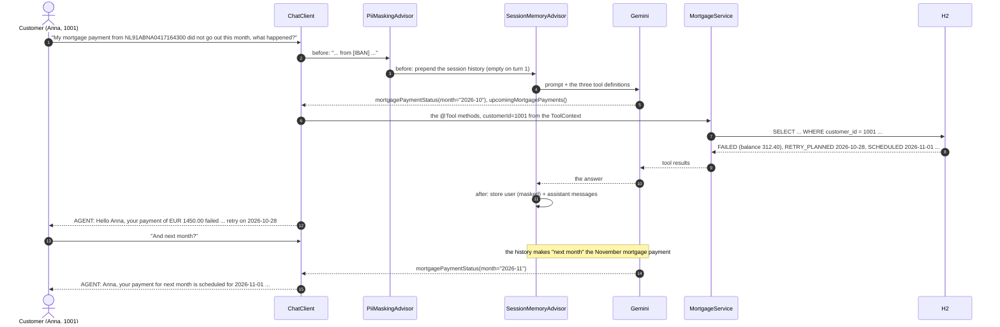

# ING demo 2: the support agent, the version in the talk

ING's second GenAI use case: customer support, first time right. The customer asks in their own words, the
agent answers from the bank's own systems of record, and nothing the customer should not share leaves the bank.

On Spring AI, one `ChatClient` and four lines of wiring:

- `defaultTools(accounts, mortgages)`: two existing `@Service` beans over `JdbcClient`, with `@Tool` on the
  methods the model may call. The model decides which one, and with which arguments.
- `defaultToolContext(...)`: the authenticated customer id, which the tools read and the model never sees.
- `PiiMaskingAdvisor`: replaces IBANs and long numbers in the message before it reaches the model or the memory.
- `SessionMemoryAdvisor`: the conversation, so turn 2 can be "And next month?".



## Run

Prerequisites: Java 17+, Maven, Gemini through Vertex AI (`GOOGLE_CLOUD_PROJECT` and `GOOGLE_CLOUD_LOCATION` in
the repo-root `.env`, `gcloud auth application-default login`). Model: `gemini-3.8-flash`.

```bash
mvn spring-boot:run -pl ing-support-agent-2
```

Optional: the Spring AI Inspector (see the [top-level README](../README.md#prerequisites); run with `-Pinspector`),
then <http://localhost:9001>. A run is two turns, four Gemini calls, about 20 seconds.

## What happens

The database (`schema.sql`, `data.sql`) holds three customers and their mortgage payments. The conversation runs
for customer 1001, Anna, whose October direct debit bounced:

| pay_month | due_date | amount | status | note |
|---|---|---|---|---|
| 2026-09 | 2026-09-01 | 1450.00 | PAID | |
| 2026-10 | 2026-10-01 | 1450.00 | FAILED | Direct debit rejected: balance was 312.40 on the due date |
| 2026-10 | 2026-10-28 | 1450.00 | RETRY_PLANNED | Automatic retry of the October payment |
| 2026-11 | 2026-11-01 | 1450.00 | SCHEDULED | |
| 2026-12 | 2026-12-01 | 1450.00 | SCHEDULED | |

Each message goes through the advisor chain, then the tool-calling loop:

| Order | Advisor | Does |
|---|---|---|
| HIGHEST + 500 | `PiiMaskingAdvisor` | replaces IBANs and 9+ digit numbers in the user message with `[IBAN]` / `[ACCOUNT-NUMBER]`, prints a `[PII]` line when it did |
| HIGHEST + 1000 | `SessionMemoryAdvisor` | loads the session's history before the call, appends the turn after; it runs after the masking, so the stored history is masked too |
| 0 | `MyLoggingAdvisor` | the orange lines: the tools on offer, the tool calls, the tool results |
| last | tool calling | runs the `@Tool` methods until the model stops asking |

The tools are plain methods on `AccountService` and `MortgageService`; `@Tool` and `@ToolParam` are the only
additions. The customer id travels in the `ToolContext` (`SupportDependencies`), set by the application from the
authenticated channel, so the model never sees or chooses it and cannot ask for another customer's data.

## What to expect

The console of a run on 26 October 2026 (orange is `MyLoggingAdvisor`, abbreviated):

```
CUSTOMER: My mortgage payment from NL91ABNA0417164300 did not go out this month, what happened?
[PII] masked before the model: My mortgage payment from [IBAN] did not go out this month, what happened?
USER:   TOOLS: ["accountBalance","mortgagePaymentStatus","upcomingMortgagePayments"]
        TEXT: My mortgage payment from [IBAN] did not go out this month, what happened?
ASSISTANT:  TOOL-CALL: mortgagePaymentStatus ({"month":"2026-10"})
            TOOL-CALL: upcomingMortgagePayments ({})
USER:   TOOL-RESPONSE: mortgagePaymentStatus: "2026-10-01: EUR 1450.00, FAILED (Direct debit rejected: balance was 312.40 on the due date)\n2026-10-28: EUR 1450.00, RETRY_PLANNED (Automatic retry of the October payment)"
        TOOL-RESPONSE: upcomingMortgagePayments: "2026-10-28: EUR 1450.00, RETRY_PLANNED (...)\n2026-11-01: EUR 1450.00, SCHEDULED\n2026-12-01: EUR 1450.00, SCHEDULED"
AGENT: Hello Anna, your mortgage payment of EUR 1450.00 on 2026-10-01 failed because the direct debit was rejected due to an account balance of EUR 312.40 on the due date. An automatic retry of this payment is planned for 2026-10-28. Please ensure sufficient funds are available in your account before that date.

CUSTOMER: And next month?
USER:   TEXT: And next month?
ASSISTANT:  TOOL-CALL: mortgagePaymentStatus ({"month":"2026-11"})
USER:   TOOL-RESPONSE: mortgagePaymentStatus: "2026-11-01: EUR 1450.00, SCHEDULED"
AGENT: Anna, your mortgage payment for next month is scheduled for 2026-11-01 in the amount of EUR 1450.00. The status of this upcoming payment is SCHEDULED. Please ensure your account has sufficient funds to cover this amount on the due date.
```

| Turn | What to point at |
|---|---|
| 1 | The `[PII]` line: the IBAN never reaches Gemini, the memory or the Inspector. The model worked out `2026-10` from "this month" and the date in the prompt, and chose two tools on its own. The reason and the retry date come from the row, not from the model. |
| 2 | "And next month?" has no subject. The session history makes it the November mortgage payment, and the model asks for `2026-11`. Nobody repeated "mortgage". |

Stable across runs: the masking, the tool calls and their arguments. Whether turn 1 calls one tool or two, and
the wording of the answers, vary with the model.

## On stage

1. Show `MortgageService`: an ordinary service over `JdbcClient`, one annotation per method. Then the
   `ChatClient` wiring in `SupportAgentApplication`: the tools, the tool context, the two advisors.
2. Run it. Turn 1: point at the `[PII]` line, then the tool calls and what came back. The pause after
   "And next month?" is the moment: no subject, the right tool, the right month.
3. Inspector, sequence view of turn 2: the history the memory advisor prepended, masked, and the tool call.

What the audience should take away: the agent's knowledge is the bank's own services, the model never holds the
customer id, the PII never leaves, and every step is on record.

## Files

| File | Role |
|---|---|
| `SupportAgentApplication.java` | the one `ChatClient`, the two-turn conversation, the in-memory `SessionService` |
| `PiiMaskingAdvisor.java` | `BaseAdvisor` at HIGHEST + 500, masks IBANs and long numbers in the user message |
| `SupportDependencies.java` | the per-conversation context (customer id) the tools read from the `ToolContext` |
| `AccountService.java`, `MortgageService.java` | the `@Service` beans with the `@Tool` methods |
| `schema.sql`, `data.sql` | the H2 tables and the three customers |
| `application.properties` | Gemini, `demo.customer-id=1001`, inspector on |
