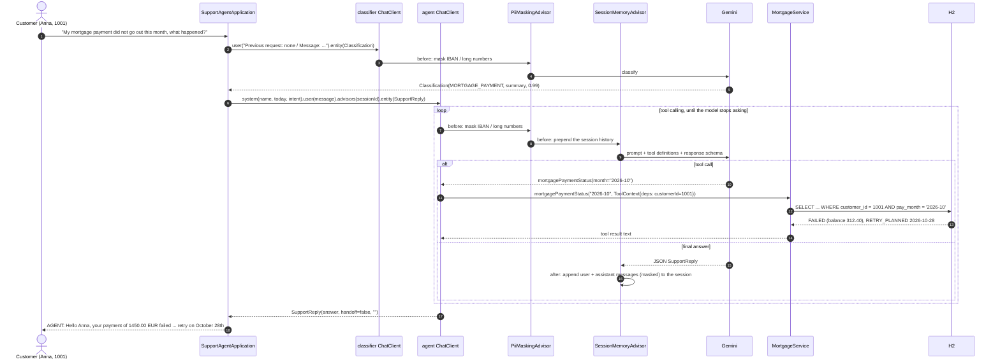
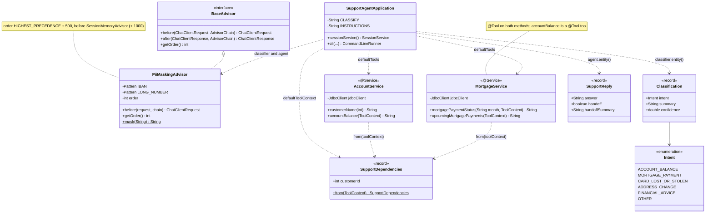

# ING demo 2: the first-time-right support agent (longer version)

The version in the talk is [`ing-support-agent-2`](../ing-support-agent-2/README.md): one `ChatClient`, two turns,
tools, tool context, PII masking and session memory. This module adds the intent classifier, the typed handoff
and the Grafana audit trail, for Q&A and the follow-up.

ING's second GenAI use case: customer support, first time right. The old path is an IVR decision tree
that guesses the intent and a colleague who starts from zero. Here each message is classified into a typed
intent, answered from the bank's own systems of record, remembered across turns, masked before it leaves the
bank, and handed to a colleague with a summary when it is out of scope.

On Spring AI: two `ChatClient`s over the same Gemini model. The **classifier** returns an `Intent.Classification`
record. The **agent** has `@Tool` methods on two existing `@Service` beans, a `SessionMemoryAdvisor`, a custom
`PiiMaskingAdvisor`, and returns a `SupportReply` record with a `handoff` flag.

Turn 1 as a sequence diagram (turn 3 is the same up to the agent call, which returns `handoff=true` without
touching a tool):



## Run

Prerequisites: Java 17+, Maven, Gemini through Vertex AI (`GOOGLE_CLOUD_PROJECT` and `GOOGLE_CLOUD_LOCATION` in
the repo-root `.env`, `gcloud auth application-default login`). Model: `gemini-3.1-pro-preview`.

```bash
# Plain: the three-turn conversation on the console, then exit
mvn spring-boot:run -pl ing-support-agent

# With the audit trail exported to Grafana (start the stack first, see below)
cd docker && docker compose up -d && cd ..
mvn spring-boot:run -pl ing-support-agent -Dspring-boot.run.profiles=otel
```

Optional: the Spring AI Inspector (see the [top-level README](../README.md#prerequisites); run with `-Pinspector`),
then <http://localhost:9001>. A plain run takes about a minute: three classifier calls and five agent calls.

## What happens

The database (`schema.sql`, `data.sql`) holds three customers and their mortgage payments. The conversation runs
for customer 1001, Anna, whose October direct debit bounced:

| pay_month | due_date | amount | status | note |
|---|---|---|---|---|
| 2026-09 | 2026-09-01 | 1450.00 | PAID | |
| 2026-10 | 2026-10-01 | 1450.00 | FAILED | Direct debit rejected: balance was 312.40 on the due date |
| 2026-10 | 2026-10-28 | 1450.00 | RETRY_PLANNED | Automatic retry of the October payment |
| 2026-11 | 2026-11-01 | 1450.00 | SCHEDULED | |
| 2026-12 | 2026-12-01 | 1450.00 | SCHEDULED | |

Each of the three scripted messages goes through two steps in `SupportAgentApplication`:

1. **Intent.** The classifier gets "Previous request: ‹last summary›\nMessage: ‹text›" and returns
   `Intent.Classification(intent, summary, confidence)`, the `Intent` enum being what the IVR used to route on
   (`ACCOUNT_BALANCE`, `MORTGAGE_PAYMENT`, `CARD_LOST_OR_STOLEN`, `ADDRESS_CHANGE`, `FINANCIAL_ADVICE`, `OTHER`).
   The classifier is stateless, so the previous turn's summary is the only context it has; it also runs the
   PII advisor.
2. **Answer.** The agent's system prompt carries the customer's name, today's date and the intent. It may only
   answer from what the tools return, and anything outside balance and mortgage questions, financial advice in
   particular, is a handoff. The advisor chain, in order:

   | Order | Advisor | Does |
   |---|---|---|
   | HIGHEST + 500 | `PiiMaskingAdvisor` | replaces IBANs and 9+ digit numbers in the user message with `[IBAN]` / `[ACCOUNT-NUMBER]` |
   | HIGHEST + 1000 | `SessionMemoryAdvisor` | loads the session's history before the call, appends the turn after; sees the masked text, so the stored history is masked too |
   | 0 | `MyLoggingAdvisor` | the orange request/response lines on the console |
   | last | tool calling | runs `@Tool` methods until the model stops asking |

   The tools are plain methods on `AccountService` and `MortgageService`, two `@Service` beans over `JdbcClient`;
   `@Tool` and `@ToolParam` are the only additions. The customer id travels in the `ToolContext`
   (`SupportDependencies`), set by the application from the authenticated channel, so the model never sees or
   chooses it and cannot ask for another customer's data.

   One turn as an activity diagram:

   ```mermaid
   flowchart TD
       A([Customer message]) --> B[Mask PII<br/>IBAN, 9+ digit numbers]
       B --> C[Classifier call<br/>Intent.Classification]
       C --> D[Mask PII again, agent call]
       D --> E[Load the session history]
       E --> F[Gemini with the tool definitions<br/>and the SupportReply schema]
       F --> G{Tool call?}
       G -- yes --> H[Run the @Tool method<br/>customerId from the ToolContext]
       H --> F
       G -- no --> I[SupportReply]
       I --> J[Append the turn to the session, masked]
       J --> K{handoff?}
       K -- no --> L([Answer to the customer])
       K -- yes --> M([Answer to the customer<br/>+ handoffSummary for the colleague])
   ```

## What to expect

The console of a plain run (25 October 2026). Orange is `MyLoggingAdvisor`, abbreviated here:

```
CUSTOMER: My mortgage payment did not go out this month, what happened?
INTENT: Classification[intent=MORTGAGE_PAYMENT, summary=The customer is inquiring about why their mortgage payment was not processed this month., confidence=1.0]
USER:   TOOLS: ["accountBalance","mortgagePaymentStatus","upcomingMortgagePayments"]  TEXT: My mortgage payment did not go out this month, what happened?
ASSISTANT:  TOOL-CALL: mortgagePaymentStatus ({"month":"2026-10"})
USER:   TOOL-RESPONSE: mortgagePaymentStatus: "2026-10-01: EUR 1450.00, FAILED (Direct debit rejected: balance was 312.40 on the due date)\n2026-10-28: EUR 1450.00, RETRY_PLANNED (Automatic retry of the October payment)"
AGENT: Hello Anna, your mortgage payment of 1450.00 EUR failed on October 1st because your account balance was only 312.40 EUR on the due date. An automatic retry for the October payment is planned for October 28th. ...

CUSTOMER: And next month?
INTENT: Classification[intent=MORTGAGE_PAYMENT, summary=The customer is asking whether their mortgage payment will be processed correctly next month., confidence=0.95]
ASSISTANT:  TOOL-CALL: upcomingMortgagePayments ({})
USER:   TOOL-RESPONSE: upcomingMortgagePayments: "2026-10-28: EUR 1450.00, RETRY_PLANNED (...)\n2026-11-01: EUR 1450.00, SCHEDULED\n2026-12-01: EUR 1450.00, SCHEDULED"
AGENT: Anna, your mortgage payment for next month is scheduled to go out on November 1st. The scheduled amount is 1450.00 EUR. ...

CUSTOMER: Should I switch to a fixed rate now? My account is NL91ABNA0417164300.
[PII] masked before the model: Previous request: The customer is asking whether their mortgage payment will be processed correctly next month.
Message: Should I switch to a fixed rate now? My account is [IBAN].
INTENT: Classification[intent=FINANCIAL_ADVICE, summary=The customer is asking for advice on whether they should switch to a fixed interest rate for their mortgage., confidence=0.95]
[PII] masked before the model: Should I switch to a fixed rate now? My account is [IBAN].
USER:   TEXT: Should I switch to a fixed rate now? My account is [IBAN].
AGENT: Anna, a colleague will contact you within one business day to help you with your question about switching to a fixed rate.
HANDOFF to a human colleague: Anna asked for financial advice regarding whether she should switch to a fixed rate mortgage. Earlier, we discussed her failed October mortgage payment of 1450.00 EUR (retry planned for Oct 28) and her scheduled November payment.
```

| Turn | What to point at |
|---|---|
| 1 | The intent is a typed value, not a string. The model asked for `2026-10` on its own ("this month" + the date in the prompt). The reason and the retry date come from the row, not from the model. |
| 2 | "And next month?" has no subject. The classifier resolves it from the previous summary; the agent resolves it from the session history. Nobody repeated "mortgage". |
| 3 | Two `[PII]` lines: the IBAN is masked for the classifier and for the agent, before either call leaves the bank. `FINANCIAL_ADVICE` → `handoff=true`, no tool call, and the summary for the colleague carries what turns 1 and 2 established. |

Stable across runs: the intents, the tool calls and their arguments, the masking, the handoff. The wording of
the answers and the confidence values vary.

## The audit trail (`otel` profile)

The same Micrometer observations Spring AI emits, exported the way the `24-observability` module of [voxxeddays2026-demo](https://github.com/tzolov/voxxeddays2026-demo) does it: metrics scraped
from `/actuator/prometheus`, traces over OTLP to Tempo, log lines to Loki, all in Grafana at
<http://localhost:3000> (no login). On this profile the app is a web app on port 8080 (the Prometheus container
scrapes that port) and stays up after the conversation, so there is time to walk through Grafana; stop it with
Ctrl-C, the data stays in the containers.

Where to look, in Grafana:

- **Explore → Tempo**, search service `ing-support-agent`: one trace per model call, six in total (three
  classifier, three agent). Turn 1's agent trace, nested as the chain nests:
  `spring_ai chat_client` → `tool_calling` → `pii_masking` → `session_memory` → `my_logging` → `call` →
  `chat gemini-3.1-pro-preview` (model, temperature, finish reason, input/output tokens), then
  `execute_tool mortgagePaymentStatus` with `spring.ai.tool.call.arguments = {"month":"2026-10"}` and the row it
  returned in `spring.ai.tool.call.result`, then the second model round. The advisor order is readable from the
  nesting. The trace id is also in the Loki lines (the "Logs for this span" link of the Tempo datasource is
  wired to the helpdesk app's label, so query Loki with the trace id by hand).
- **Explore → Prometheus**: `gen_ai_client_operation_seconds_count{application="ing-support-agent"}` (8 calls),
  `spring_ai_tool_seconds_count` by `spring_ai_tool_definition_name` (mortgagePaymentStatus 2,
  upcomingMortgagePayments 1, accountBalance 1), `gen_ai_client_token_usage_total` by `gen_ai_token_type`
  (5791 input, 477 output, 9996 total; the gap is Gemini's thinking). The **Spring AI** dashboard reads the same
  metrics; its log panels are hardcoded to the helpdesk app of `24-observability` in voxxeddays2026-demo, use Explore for logs.
- **Explore → Loki**, `{app="ing-support-agent"} |= "Chat Model Prompt"`: the eight prompts as Gemini received
  them, each line tagged with its trace id (a link back to the trace). `|= "NL91"` finds nothing;
  `|= "[IBAN]"` finds the two masked prompts of turn 3.

Which spans may carry content is the point of the profile's settings (`application-otel.properties`):

| Switch | Setting | Why |
|---|---|---|
| `spring.ai.chat.client.observations.log-prompt` | off | the ChatClient observation is at the top of the chain and sees the message as the customer typed it, IBAN included |
| `spring.ai.chat.observations.log-prompt` / `log-completion` | on | the model observation runs after `PiiMaskingAdvisor`: this is what Gemini actually received and answered |
| `spring.ai.tools.observations.include-content` | on | the arguments the model chose and what the bank system answered: the audit trail a risk team asks for |

ING's GenAI platform runs on GCP; the same OTLP export goes to Cloud Trace and Cloud Monitoring without new code.

Build note: the Google GenAI SDK pulls protobuf-java 3.25 and the OpenTelemetry starter's `opentelemetry-proto`
is generated for protobuf 4, so the pom pins protobuf-java 4.32 in `dependencyManagement`; the 4.x runtime loads
the SDK's 3.x-generated classes. Without the pin the context fails with
`NoClassDefFoundError: com/google/protobuf/RuntimeVersion$RuntimeDomain`. Without the profile the starter is on
the classpath but exports nothing, so the plain run needs no Docker.

## On stage

1. Show `MortgageService`: an ordinary service over `JdbcClient`, one annotation per method. Then the `ChatClient`
   wiring: `defaultTools(accounts, mortgages)`, the tool context with the customer id, the three advisors.
2. Run it and narrate the three turns with the table above. The pause after "And next month?" is the moment.
3. Inspector, sequence view of turn 1: lanes for the app, the advisors, Gemini and the tools, and the prompt as
   the model saw it. Then turn 3: the masked message in the memory.
4. If the stack is up: Grafana, Explore → Tempo, the turn-1 trace. Expand `execute_tool mortgagePaymentStatus`.
   "This is what the agent did, with which arguments, and what it got back, for every call, for every customer."

What the audience should take away: the agent's knowledge is the bank's own services, the model never holds the
customer id, the PII never leaves, and every step is on record.

## Files



| File | Role |
|---|---|
| `SupportAgentApplication.java` | the classifier, the agent, the scripted conversation, the in-memory `SessionService` |
| `Intent.java` | the intent enum and the `Classification` record the classifier returns |
| `SupportReply.java` | `answer`, `handoff`, `handoffSummary`, what the agent returns on every turn |
| `PiiMaskingAdvisor.java` | `BaseAdvisor` at HIGHEST + 500, masks IBANs and long numbers in the user message |
| `SupportDependencies.java` | the per-conversation context (customer id) the tools read from the `ToolContext` |
| `AccountService.java`, `MortgageService.java` | the `@Service` beans with the `@Tool` methods |
| `schema.sql`, `data.sql` | the H2 tables and the three customers |
| `application.properties` | Gemini, `demo.customer-id=1001`, inspector on, exports off |
| `application-otel.properties` | the audit trail: web on 8080, Prometheus, OTLP to Tempo, the content switches |
| `logback-spring.xml` | console always; the Loki appender under the `otel` profile |
